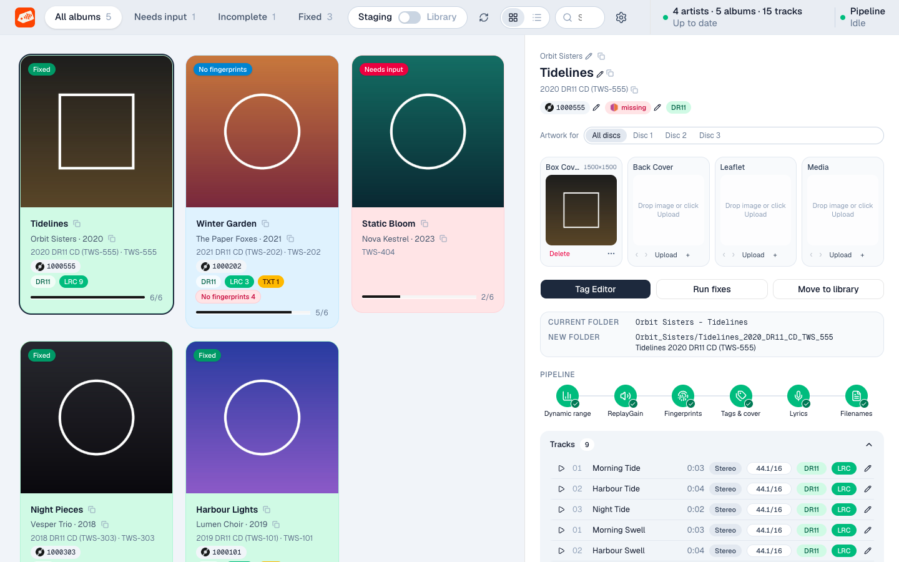
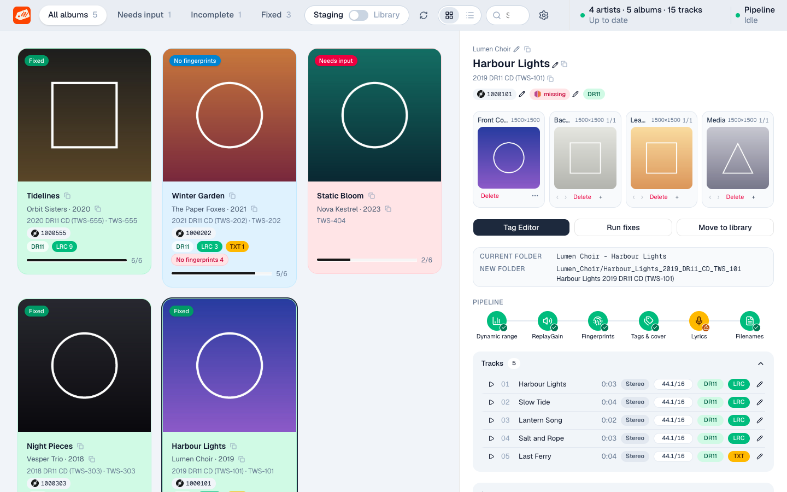
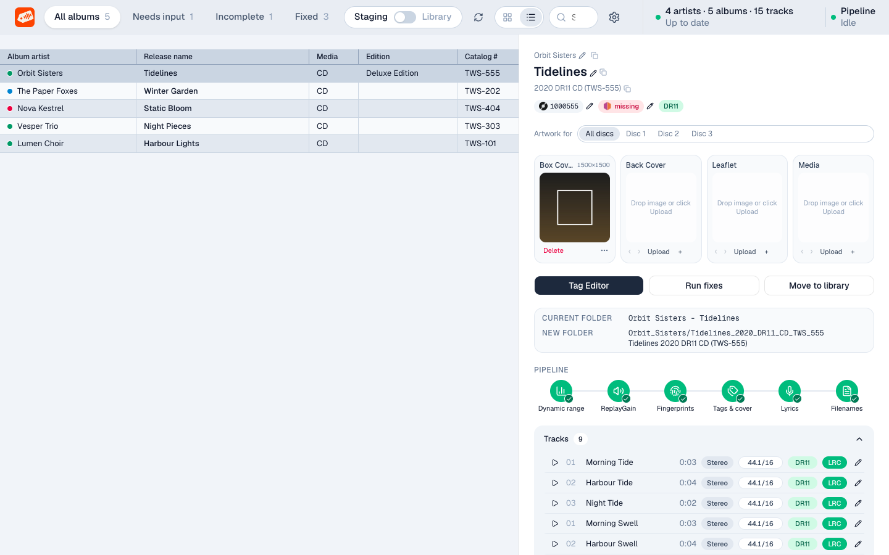
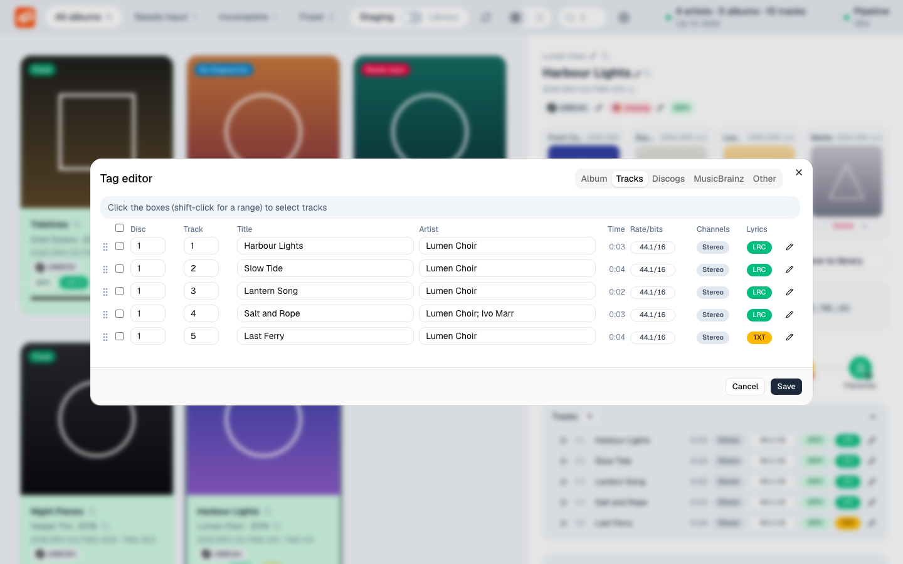
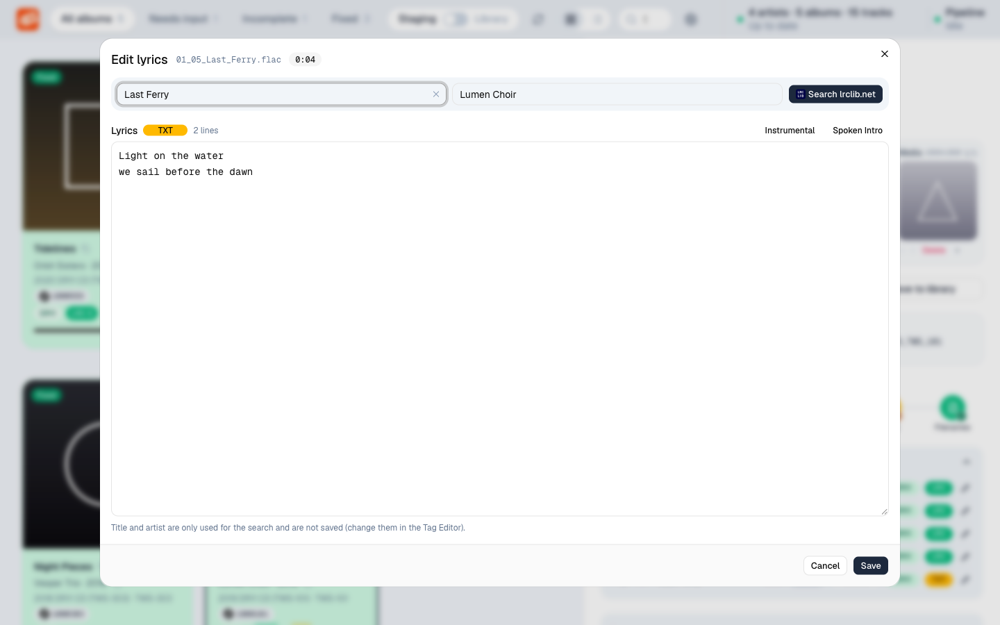
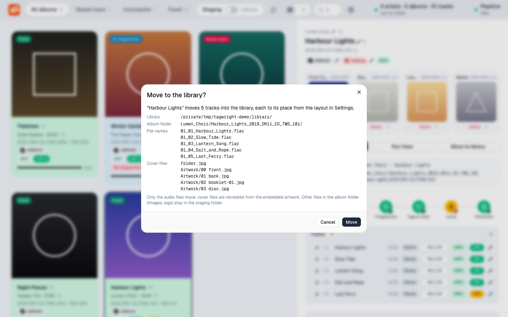
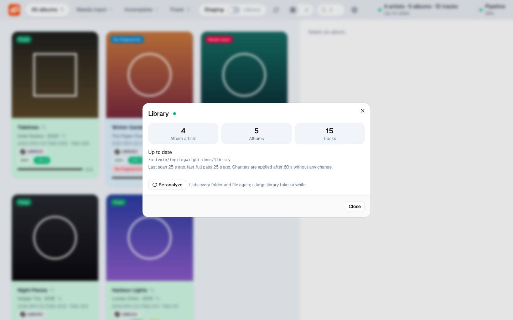
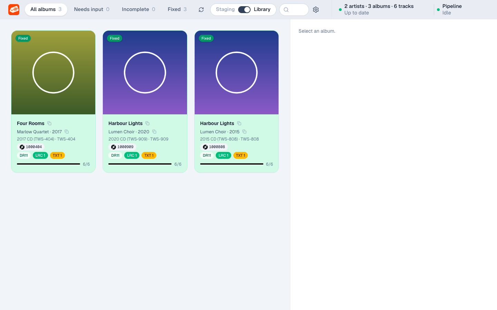
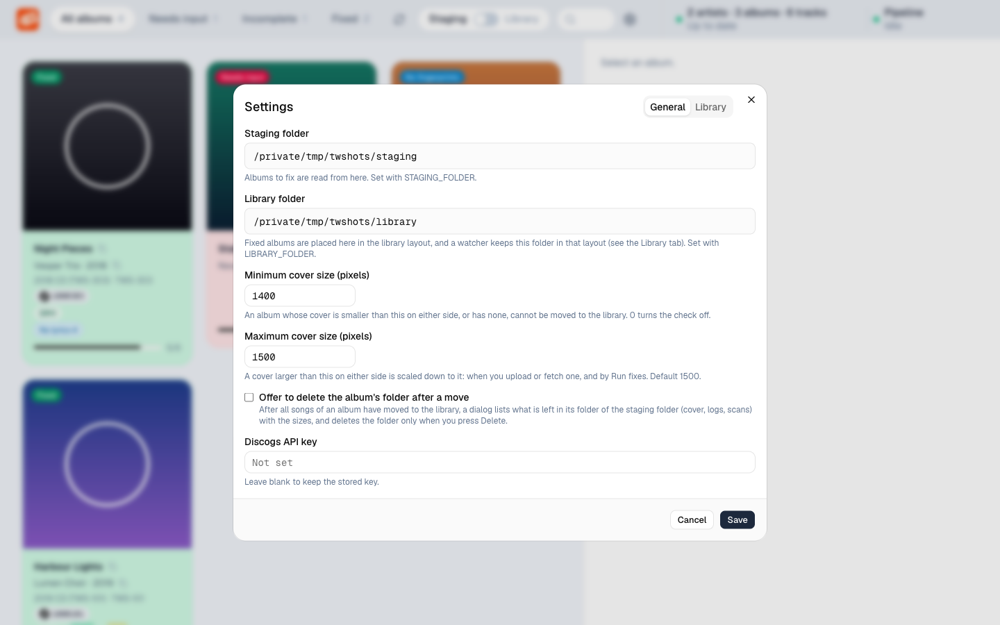
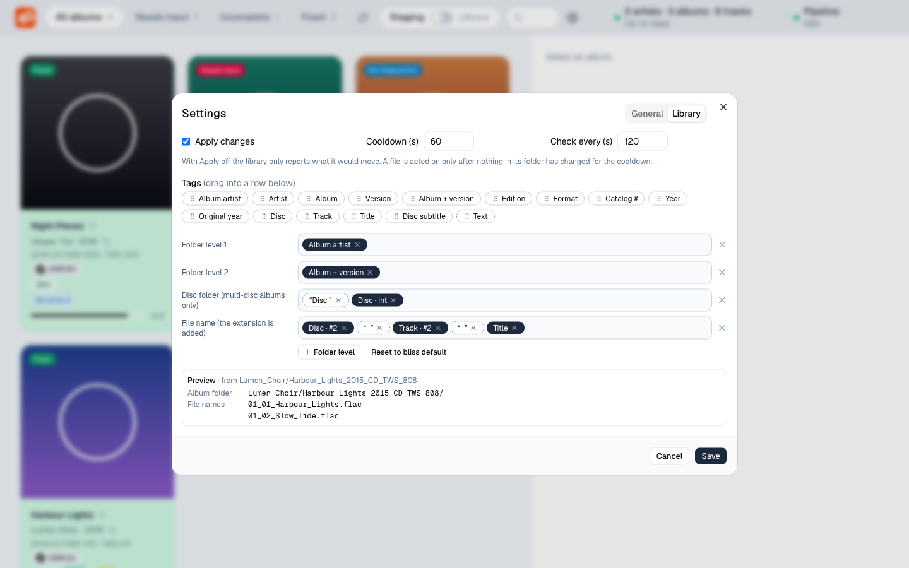

# Tagwright

[](https://github.com/koehntopp/tagwright/actions/workflows/image.yml)
[](https://github.com/koehntopp/tagwright/releases/latest)
[](LICENSE)
[](https://github.com/koehntopp/tagwright/pkgs/container/tagwright)
[](https://www.python.org/)

A self-hosted web app that turns freshly downloaded FLAC and MP3 albums into clean, tagged, loudness-analysed albums with lyrics, and keeps your music library in one canonical folder layout.

One user, one browser tab. FastAPI backend, Next.js frontend, no database server, no account. The decisions behind every behaviour are in [docs/adr/](docs/adr/README.md).



## What it does

You point Tagwright at two folders: a **staging folder** (where downloads land) and a **library folder** (what your music server reads). It then helps you take an album from one to the other.

1. **See what each album needs.** Every folder directly in the staging folder is one album, with everything below it (a box set with `Disc 1 - ...` subfolders is one card, ADR 0076), shown as a card with cover, artist, album, year, Discogs ID, dynamic range, lyrics and a pipeline progress bar. The top bar filters: *Needs input*, *Incomplete*, *Fixed*. A switch next to it shows the albums as cards or as a compact, sortable list (ADR 0085, 0087).
2. **Fix it.** *Run fixes* runs the pipeline on the album and streams a live log.
3. **Correct what automation cannot.** Choose the Discogs and MusicBrainz release, edit tags, fix lyrics, replace the cover.
4. **Move it to the library.** *Move to library* places the files in the library layout.

### Card colours

| Colour | Meaning |
|---|---|
| Green, *Fixed* | Every pipeline step is done |
| Blue, *Incomplete* | Has a Discogs release, some steps are missing; the card lists which |
| Red, *Needs input* | No Discogs release yet. This is the only warning shown until one is assigned |

## The pipeline

One run does these steps in this order (ADR 0036):

1. **Dynamic range** with [`drcalc`](https://github.com/koehntopp/drcalc) (`DYNAMIC_RANGE`, `ALBUM_DR`)
2. **ReplayGain** with `rsgain`
3. **Fingerprints** with [`fpscan`](https://github.com/koehntopp/fpscan) (AcoustID)
4. **Tags & cover** from the assigned Discogs release
5. **Lyrics** from [lrclib.net](https://lrclib.net), synced (LRC) when available
6. **Filenames** in the layout's file name pattern

The inspector shows each step as done or partial, and which tracks lack it. Notes in the inspector all look alike: a red **Missing** or **Mismatch** with a stop symbol, warnings and hints with a warning sign, and a button where something can be done (*Run fixes*, *MusicBrainz*). Under the notes a grey box shows the current folder, the new folder with the album title and version, and **In your library**: the other versions of the same Discogs master that are already in the library (ADR 0082, 0083). The track list shows each track's time, channels, sample rate and bit depth, dynamic range and lyrics (`LRC`, `TXT`, `INS`, `---`).





Tags Tagwright writes are never read back as input, tags owned by Discogs are read-only in the editor, and a user-owned tag is never overwritten by automation (ADR 0004, 0014).

## Editing

**Tag editor** has five tabs: Album, Tracks, Discogs, MusicBrainz and Other (every tag not shown elsewhere). The Album tab shows the album's format (empty means CD) and edition as plain fields you can type over (ADR 0097). Tracks lets you change disc, track number, title and artist (several artists as `A; B`, saved as one value each, ADR 0100), reorder by drag and drop, and see each track's time, sample rate and bit depth, channels and lyrics. Disc subtitles are bands between the tracks: a band per disc on a multi-disc album, and a band wherever the subtitle changes inside a disc, with a pen to type one, "+ divider here" to add one and an x to remove one (ADR 0081).



**Discogs** search assigns an album's files to the tracks of a release, which matters when the download holds only a subset of the release. The Discogs-owned tags (album name, version, catalog number, year, ...) are written at once. Artists and credits are written one name per value, as Roon reads them: `ARTIST`, `COMPOSER`, `LYRICIST`, `ARRANGER`, `CONDUCTOR`, `REMIXER`, `MIXER`, `PRODUCER`, `ENGINEER`, and `PERSONNEL` (`Name - Role`, mastering included) for every other role; credits Discogs limits to some tracks go only on those tracks. Credit lists and leftovers of earlier taggers are removed, and a file is never saved when the assignment would empty its title, artist, album, album artist, track or disc number (ADR 0100). **MusicBrainz** search picks the matching release, assigns the files to its tracks the same way, stores its IDs and links, and shows a red **Mismatch** when its year differs from the Discogs release, which stops *Move to library* until the release is fixed (ADR 0083). Both dialogs show the release's subtitles as dividers with a "Release" / "Keep mine" choice. Both dialogs have an "Import song titles" checkbox (remembered; on for Discogs, off for MusicBrainz): off imports only the album data, on also writes the release's titles, track and disc numbers and disc subtitles, so titles you prefer, for example without kanji, stay in the files. With it off, an empty disc number, track number or title is still filled from the release. Discogs positions with a media label (`SACD-1`, `CD-1`, `DVD-1`, `BD1-2`) give each disc of a mixed-media set its own number (ADR 0101). A release track can go to one file on each disc of the album: a Blu-ray with the same songs in several mixes, listed once on Discogs, is assigned completely, each disc numbered from 1, and each mix takes the songs under the Discogs heading that matches its subtitle (ADR 0102).

**Lyrics** are edited per track, optionally after searching lrclib.net under another title or artist.



**Cover**: the album details use the full inspector width, and four equal cover fields sit below them: **Front Cover** (one image), **Back Cover**, **Leaflet** and **Media** (several images each, cycled with the arrows). Each field accepts a dropped, uploaded or pasted image (click the field, then Cmd/Ctrl+V, ADR 0096); the front field also has two cover search sites and **remove**. Images are scaled down to the maximum cover size (Settings, 1500 px by default) and embedded in every audio file. A front cover below the minimum size (1400 px by default) keeps the album from moving (ADR 0090).

**Multi-disc albums** show an *Artwork for* switch above the fields: *All discs* or one disc, so a disc can have its own front, back, leaflet and media images. Under *All discs* the first field is the **Box Cover**, which a box set can have besides the disc covers; when all discs share one front cover and there is no box cover, it is that **Front Cover** instead (ADR 0098, 0099, 0107).

**Cover files**: when an album moves to the library, and whenever its artwork changes there, `folder.jpg` and the `Artwork/` folder (a copy of the front as `00 front.jpg`, then the numbered back, leaflet and media images) are written from the embedded images, and files for removed images are deleted. A changed cover from a Discogs assignment or from Run fixes counts too, and albums that were already in the library get their missing cover files at the watcher's next full pass (ADR 0104, 0105). With disc folders each disc folder gets its own set, and the album folder's `folder.jpg` is the box cover, the layout Roon reads for box sets (ADR 0091, 0098, 0099).

## Moving to the library

*Move to library* shows exactly what will happen first: the album folder and every file name, from your layout. Only `fixed` albums can move, nothing is overwritten and nothing is merged into an existing folder (ADR 0011). An optional setting offers to delete what is left of the album's staging folder afterwards, after listing it (ADR 0072).



## The library watcher

A background watcher keeps the library folder in the layout. It notices changes without re-listing the whole share (it compares directory modification times), waits for a cooldown after the last change, and only then renames and moves. It never overwrites, removes only empty folders and obvious litter (`.DS_Store`, Synology's `@eaDir`). On every full pass (after a restart, daily, or with **Re-analyze**) it also removes empty folders left behind and writes the missing cover files of albums already in the library (ADR 0103, 0104). When it moves the album you have open, the inspector and an open Tag Editor follow it to the new folder.

The top bar shows album artists, albums and tracks, and what the watcher is doing. Click it for recent activity and a manual **Re-analyze** button.



Other programs can read the library as CSV from `GET /api/library/albums.csv` (the columns of the discogs `albums.csv`; `?path_prefix=/Volumes/flac` rewrites the folder paths for a client that mounts the library elsewhere, ADR 0077).

The **Staging | Library** switch in the top bar flips the board to the library, so you can fix details of albums that are already there.



### Settings

Settings shows the two folders (read-only, from the environment), the minimum and maximum cover size, the option to delete the leftover staging folder after a move, and the Discogs API key. Tab *Library* holds the layout.



### The layout

Settings, tab *Library*, defines the layout by dragging tags into rows: one row per folder level, one for the disc folder of multi-disc albums, one for the file name. A live preview uses a real album. *Reset to bliss default* restores `Artist/Album_Year_DRxx_Format_Catalog/01_01_Title.flac`.



## Run it

Requirements: Python 3.14, [`uv`](https://docs.astral.sh/uv/), and on `PATH`: `drcalc`, `rsgain`, `fpscan`.

```bash
STAGING_FOLDER=/path/to/staging LIBRARY_FOLDER=/path/to/library DATA_DIR=./data ./app.py
```

Open <http://localhost:8080>. In Settings enter your **Discogs API key** (required for the Discogs step). It lives in `DATA_DIR/settings.json` and is never logged or returned by the API. lrclib.net needs no key: Tagwright identifies itself with its registered application ID.

| Variable | Meaning |
|---|---|
| `STAGING_FOLDER` | Staging folder (required) |
| `LIBRARY_FOLDER` | Library folder (required) |
| `DATA_DIR` | Settings, library index, MusicBrainz cache (required) |
| `PORT` | HTTP port (optional, 8080) |
| `LOG_LEVEL` | `DEBUG`, `INFO`, `WARNING` or `ERROR` (optional, `INFO`); `DEBUG` adds per-file detail |
| `SYSLOG_HOST` | Also send the log to this syslog host (optional) |
| `SYSLOG_PORT` | Syslog port (optional, 514) |
| `SYSLOG_PROTOCOL` | `udp` (default) or `tcp` (optional) |

There are no default paths: Tagwright refuses to start when one of the three is missing. Paths must be absolute. Staging, library and every path the API accepts are checked against these two folders. They are not editable in Settings, which shows them read-only, as host paths (the bind-mounted path or the NFS export) when it can tell.

### Logging

The program logs jobs, moves, renames, assignments, tag, lyrics and cover edits and settings saves to standard output (`docker logs`). Set `SYSLOG_HOST` to send the same lines to a syslog server too (not needed when Docker's syslog log driver already ships the container output). Successful status polls of the page are left out of the access log. API keys are never logged ([ADR 0064](docs/adr/0064-logging-and-syslog.md)).

### Docker

A published image (amd64 and arm64) is on GitHub's registry; each release also has its own tag (for example `:0.7`, [ADR 0070](docs/adr/0070-releases.md)):

```bash
docker pull ghcr.io/koehntopp/tagwright:latest
```

Or build and run it with compose:

```bash
docker compose up -d
```

Set `STAGING_HOST_PATH` and `LIBRARY_HOST_PATH` in a `.env` file next to [compose.yaml](compose.yaml); it mounts them at `/staging` and `/library`, and `./data` at `/data`. The image contains Python, `drcalc`, a source-built `rsgain` and `fpscan`.

Tagwright has no authentication. Run it on a trusted network or behind a reverse proxy that authenticates (ADR 0007).

## Development

```bash
uv run --group test pytest            # tests use synthetic albums in a temp directory
uv run ruff check . && uv run ruff format --check .
cd ui && npm run build                # frontend; commit the resulting static/ui/
./scripts/retype-covers.py <paths>     # one-off: retype single untyped embedded covers to Front Cover (3); --write saves
./scripts/retype-covers.py --multi-albums <paths>  # list only album folders with multi-picture files
./scripts/fix-credits.py <paths>       # one-off: rewrite artists and credits one value per name from Discogs, drop legacy tags (ADR 0100); files are matched by Discogs position, else by title; --write saves
```

Layout: `app.py` (web layer), `pipeline/` (the steps), `library/` (watcher, planner, layout template), `ui/` (Next.js, shadcn/ui), `docs/adr/` (the specification).

Never run tests or experiments against a real library (ADR 0018). Contributors and AI agents: read [AGENTS.md](AGENTS.md) first; the ADRs are binding.

## Licence

Tagwright is free software under the [GNU General Public License, version 3 or later](LICENSE). It builds on `mutagen` and `Unidecode`, which are GPL, so the combined program and the Docker image are GPL ([ADR 0062](docs/adr/0062-license-gpl-3-or-later.md)). [NOTICE](NOTICE) lists the third-party software it uses and the image contains.
