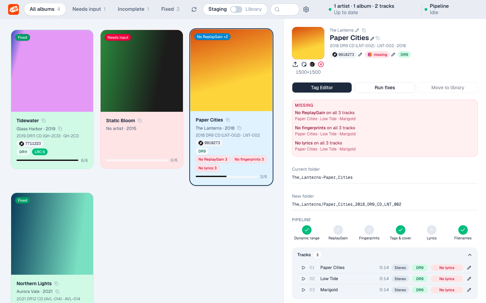
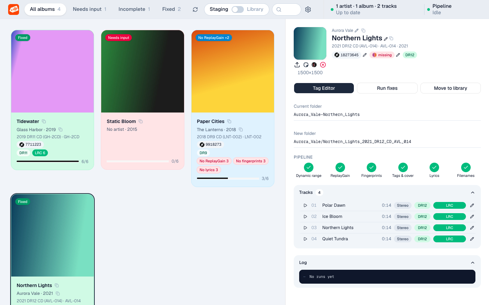
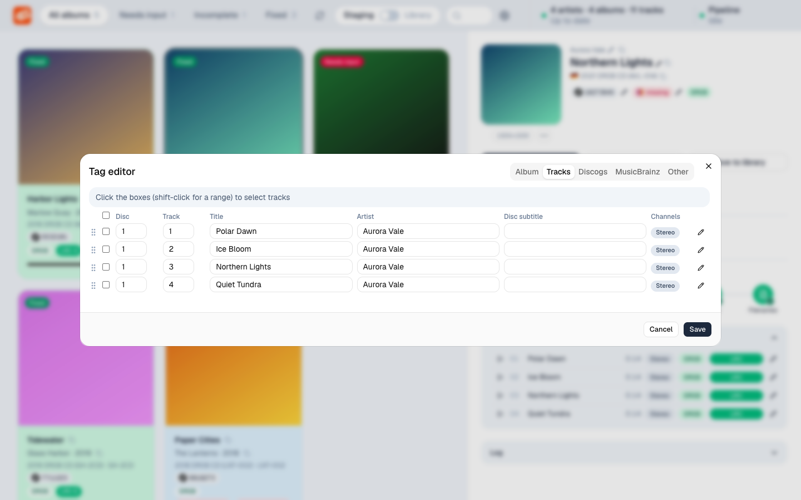
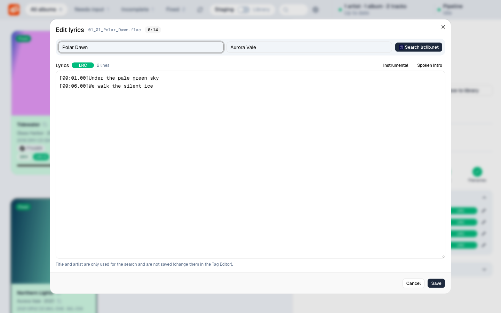
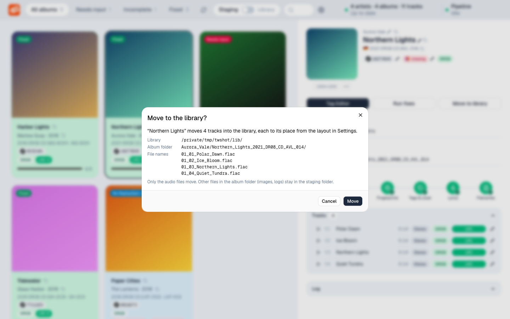
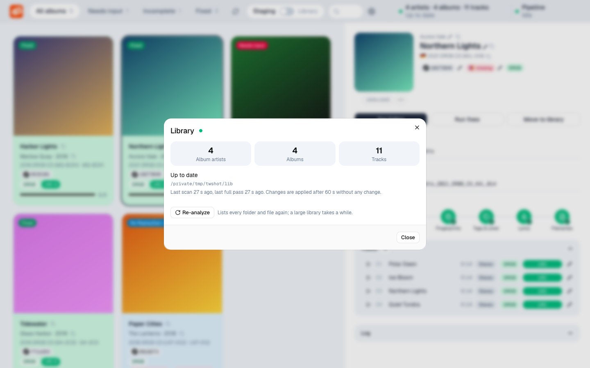
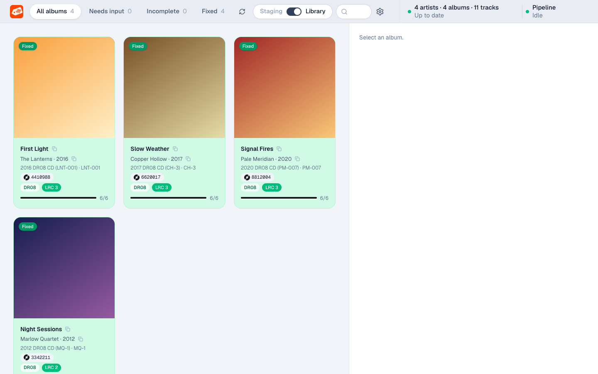
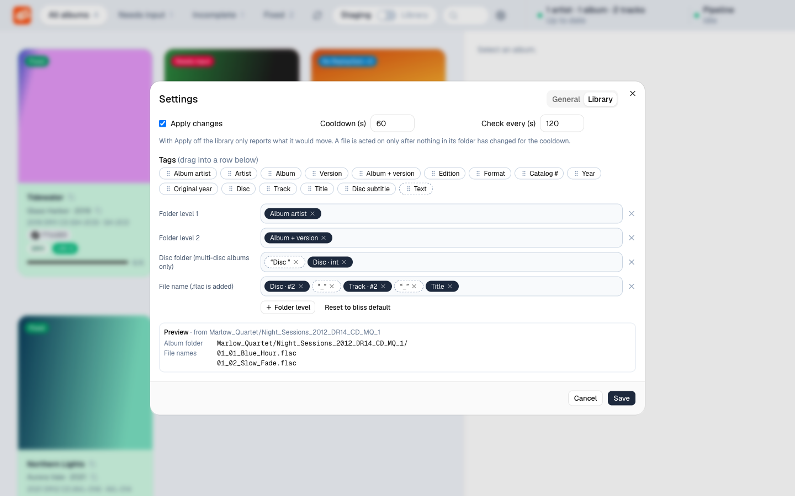

# Tagwright

A self-hosted web app that turns freshly downloaded FLAC albums into clean, tagged, loudness-analysed albums with lyrics, and keeps your music library in one canonical folder layout.

One user, one browser tab. FastAPI backend, Next.js frontend, no database server, no account. The decisions behind every behaviour are in [docs/adr/](docs/adr/README.md).



## What it does

You point Tagwright at two folders: a **staging folder** (where downloads land) and a **library folder** (what your music server reads). It then helps you take an album from one to the other.

1. **See what each album needs.** Every album in the staging folder is a card with cover, artist, album, year, Discogs ID, dynamic range, lyrics and a pipeline progress bar. The top bar filters: *Needs input*, *Incomplete*, *Fixed*.
2. **Fix it.** *Run fixes* runs the pipeline on the album and streams a live log.
3. **Correct what automation cannot.** Choose the Discogs and MusicBrainz release, edit tags, fix lyrics, replace the cover.
4. **Move it to the library.** *Move to library* places the files in the library layout.

### Card colours

| Colour | Meaning |
|---|---|
| Green, *Fixed* | Every pipeline step is done |
| Blue, *Incomplete* | Has a Discogs release, some steps are missing; the card lists which |
| Red, *Needs input* | No Discogs release yet. This is the only warning shown until one is assigned |

## The pipeline

One run does these steps in this order (ADR 0036):

1. **Dynamic range** with [`drcalc`](https://github.com/koehntopp/drcalc) (`DYNAMIC_RANGE`, `ALBUM_DR`)
2. **ReplayGain** with `rsgain`
3. **Fingerprints** with `fpcalc` (AcoustID)
4. **Tags & cover** from the assigned Discogs release
5. **Lyrics** from [lrclib.net](https://lrclib.net), synced (LRC) when available
6. **Filenames** in the layout's file name pattern

The inspector shows each step as done or partial, and which tracks lack it.



Tags Tagwright writes are never read back as input, tags owned by Discogs are read-only in the editor, and a user-owned tag is never overwritten by automation (ADR 0004, 0014).

## Editing

**Tag editor** has four tabs: Album, Tracks, Discogs and MusicBrainz. Tracks lets you change disc, track number, title, artist and disc subtitle, reorder by drag and drop, and see whether a track is Stereo, Mono, 5.1 or 7.1.



**Discogs** search assigns an album's files to the tracks of a release, which matters when the download holds only a subset of the release. The Discogs-owned tags (album name, version, catalog number, year, ...) are written at once. **MusicBrainz** search picks the matching release and stores its IDs and links, and warns when its year differs from the Discogs release.

**Lyrics** are edited per track, optionally after searching lrclib.net under another title or artist.



**Cover**: the pixel size is shown and a small cover is flagged. Drop an image on the cover or use the upload button; it is scaled to 1500 px and embedded. Links open cover searches on external sites.

## Moving to the library

*Move to library* shows exactly what will happen first: the album folder and every file name, from your layout. Only `fixed` albums can move, nothing is overwritten and nothing is merged into an existing folder (ADR 0011).



## The library watcher

A background watcher keeps the library folder in the layout. It notices changes without re-listing the whole share (it compares directory modification times), waits for a cooldown after the last change, and only then renames and moves. It never overwrites, removes only empty folders and obvious litter.

The top bar shows album artists, albums and tracks, and what the watcher is doing. Click it for recent activity and a manual **Re-analyze** button.



The **Staging | Library** switch in the top bar flips the board to the library, so you can fix details of albums that are already there.



### The layout

Settings, tab *Library*, defines the layout by dragging tags into rows: one row per folder level, one for the disc folder of multi-disc albums, one for the file name. A live preview uses a real album. *Reset to bliss default* restores `Artist/Album_Year_DRxx_Format_Catalog/01_01_Title.flac`.



## Run it

Requirements: Python 3.14, [`uv`](https://docs.astral.sh/uv/), and on `PATH`: `drcalc`, `rsgain`, `fpcalc`.

```bash
STAGING_FOLDER=/path/to/staging LIBRARY_FOLDER=/path/to/library DATA_DIR=./data ./app.py
```

Open <http://localhost:8080>. In Settings enter your **Discogs API key** (required for the Discogs step). It lives in `DATA_DIR/settings.json` and is never logged or returned by the API. lrclib.net needs no key: Tagwright identifies itself with its registered application ID.

| Variable | Default | Meaning |
|---|---|---|
| `STAGING_FOLDER` | `/staging` | Staging folder |
| `LIBRARY_FOLDER` | `/flac/ingest` | Library folder |
| `DATA_DIR` | `./data` | Settings, library index, MusicBrainz cache |
| `PORT` | `8080` | HTTP port |

Paths must be absolute. Staging, library and every path the API accepts are checked against these two folders. They are not editable in Settings, which shows them read-only, as host paths (the bind-mounted path or the NFS export) when it can tell.

### Docker

```bash
docker compose up -d
```

[compose.yaml](compose.yaml) mounts staging at `/staging`, the library at `/flac/ingest` and `./data` at `/data`. The image contains Python, `fpcalc`, `drcalc` and a source-built `rsgain`. `./deploy-linux.sh` builds an amd64 image, copies it to a Linux host and recreates a Dockge stack (edit the host and stack name at the top).

Tagwright has no authentication. Run it on a trusted network or behind a reverse proxy that authenticates (ADR 0007).

## Development

```bash
uv run --group test pytest            # tests use synthetic albums in a temp directory
uv run ruff check . && uv run ruff format --check .
cd ui && npm run build                # frontend; commit the resulting static/ui/
```

Layout: `app.py` (web layer), `pipeline/` (the steps), `library/` (watcher, planner, layout template), `ui/` (Next.js, shadcn/ui), `docs/adr/` (the specification).

Never run tests or experiments against a real library (ADR 0018). Contributors and AI agents: read [AGENTS.md](AGENTS.md) first; the ADRs are binding.
